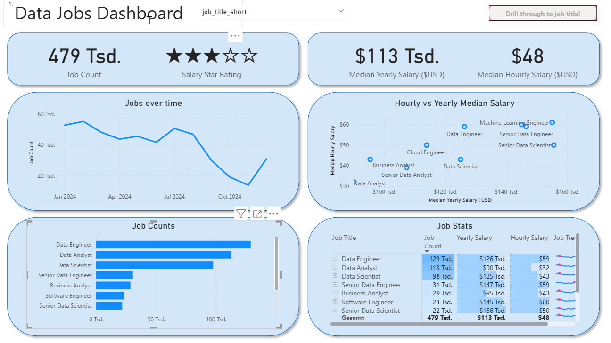
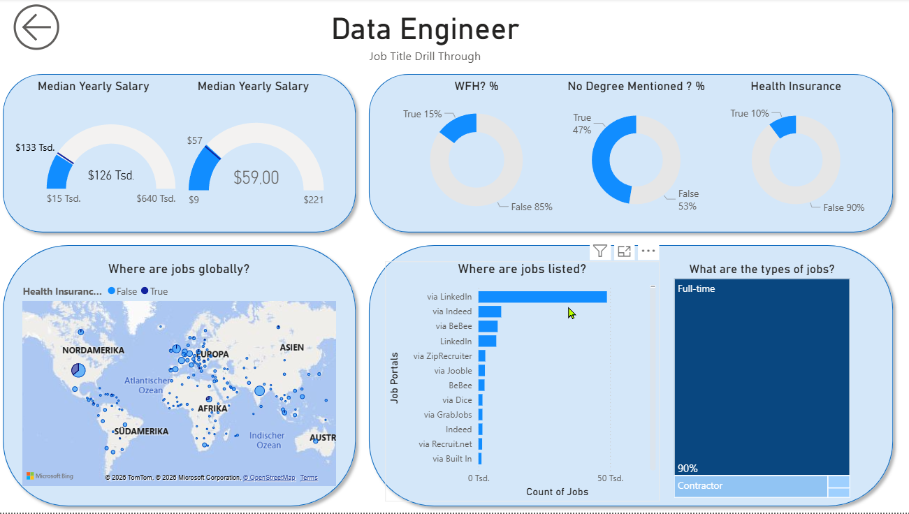
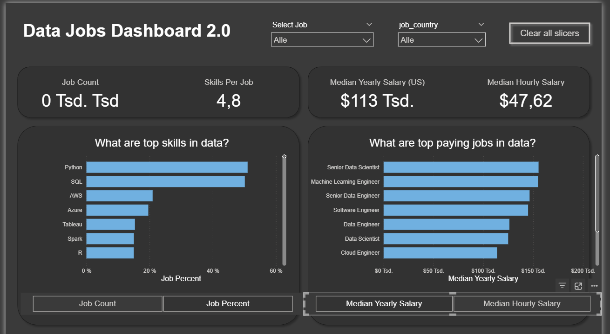

# Power BI for Data Analytics

This repository showcases course content and hands-on portfolio projects from the **Power BI for Data Analytics** course by **Luke Barousse**. The course provides an end-to-end foundation in business intelligence, transforming raw tech job market data into production-grade interactive dashboards using Power Query ETL, M code, star schema data modeling, and advanced DAX measures.

## Course Content

* **Power BI Ecosystem & Data Modeling:** Core BI architecture (Power BI Desktop, Service, Fabric) and star schema design with fact and dimension tables.
* **Standard & Comparison Visuals:** Clustered, stacked, and 100% stacked bar/column charts with visual, page, and report-level filters.
* **Trend & Composition Analysis:** Line, area, and combo line/column charts with drill-downs, plus pie, donut, scatter plots, and treemaps.
* **Geospatial & Specialized Visuals:** Bubble maps, filled choropleths, ArcGIS integrations, ribbon, waterfall, and funnel charts.
* **Tabular Reporting & KPI Cards:** Tables and matrices with Quick Measures, conditional formatting, sparklines, KPI visuals, and gauges.
* **Interactivity & Navigation:** Synchronized slicers, interactive cross-filtering, action buttons, and custom bookmark navigation.
* **Power Query ETL & Data Profiling:** Multi-source data ingestion (Web, Folders, Databases), Import vs. DirectQuery modes, and column quality profiling.
* **Transformations & M Code:** Cleaning text, splitting delimiters, unpivoting columns, adding conditional/custom columns, and M code editing.
* **Combining Queries & Relationships:** Appending tables, merging queries across 6 join types, managing cardinality, and setting cross-filter directions.
* **DAX & Dynamic Parameters:** Explicit measures, calculated columns/tables, row vs. filter context with `CALCULATE`, and field/numeric range parameters.

## Tools

| Tool | Purpose |
| :--- | :--- |
| **Power BI Desktop** | Visualizations, report design, and interactive dashboards |
| **Power Query & M** | ETL processes, data cleaning, and transformations |
| **DAX** | Data modeling, calculated columns, and dynamic measures |
| **Git & GitHub** | Version control, documentation, and portfolio hosting |

## Capstone Project:

The course culminates in a capstone project focused on real-world labor market analytics. Using a normalized dataset of tech job postings, you build an interactive two-page Power BI reporting suite to analyze compensation patterns, market demand, and role specifications across global tech hubs.

### Skills Demonstrated:

1.	**Star Schema Modeling:** Structured fact and dimension tables into an optimized star schema with managed 1:n relationships to ensure efficient filter propagation. 
2.	**Power Query ETL:** Applied data transformation and cleansing workflows to handle disparate job market attributes and prepare normalized datasets. 
3.	**Explicit DAX Measures:** Authored modular DAX calculations for core KPIs, including total job counts, median yearly compensation, and median hourly rates. 
4.	**Advanced Visual Implementation:** Deployed New Card KPIs, gauge charts for salary target ranges, treemaps, sparkline matrices, and geographic bubble maps. 
5. **Target & Distribution Visuals:** Built advanced UI visuals including gauge meters with dynamic min/max thresholds, donut proportion charts, treemaps, and geographic bubble maps.
6. 	**Cross-Report Drill-Through:** Built automated page drill-through routing to pass individual role context into a dedicated deep-dive view with native back-button navigation. 
7.	**Report UI & Container Layout:** Applied modern UI principles using grouped, rounded background shape containers and transparent visual styling to separate content areas.
8. **Dynamic Field Parameters:** Implemented disconnected parameter tables to enable dynamic axis switching, letting users toggle visual metrics between counts and percentages or hourly and yearly pay.

## Dashboad Overview

### High-Level Market View - Version 1

### Drill-Through-Page - Version 1

[Download Power BI (Dashboard Version 1)](2_Visualizations_Dashboard_For_Github.pbix)

### High-Level Market View - Version 2

 

[Download Power BI (Dashboard Version 2)](2_Visualizations_Dashboard_For_Github.pbix)